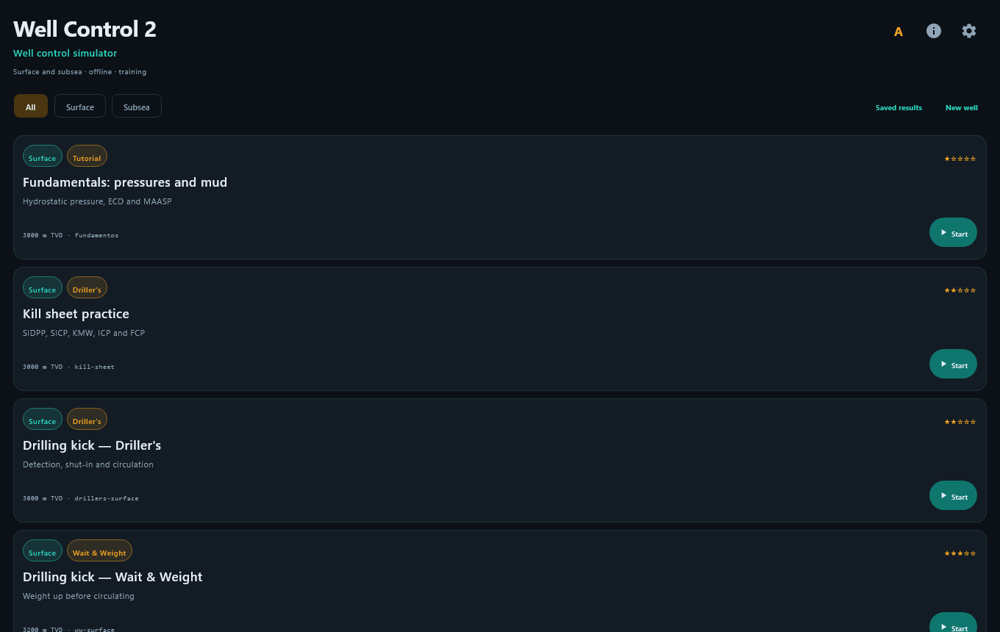
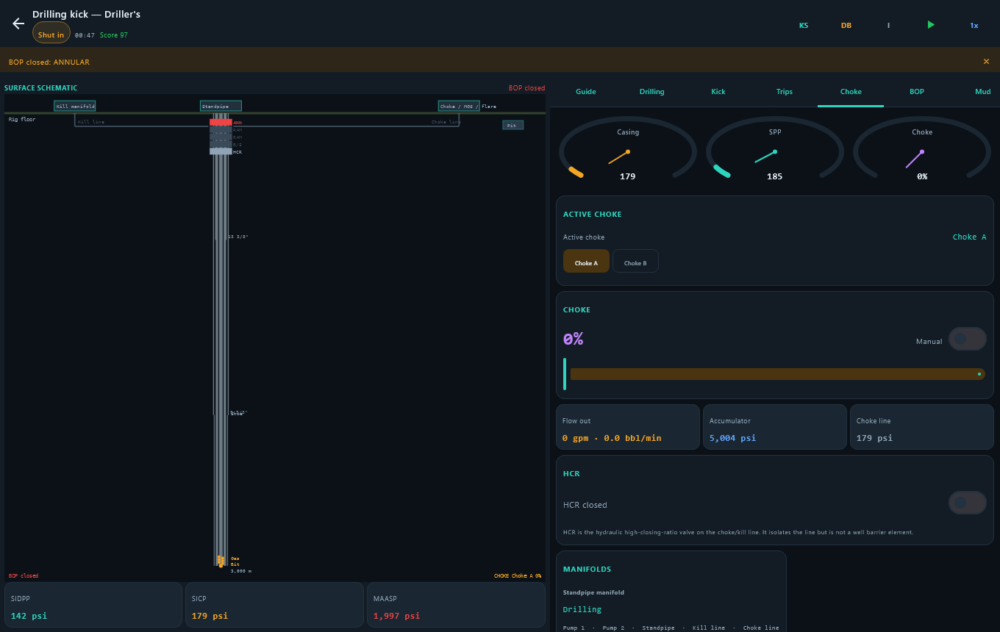
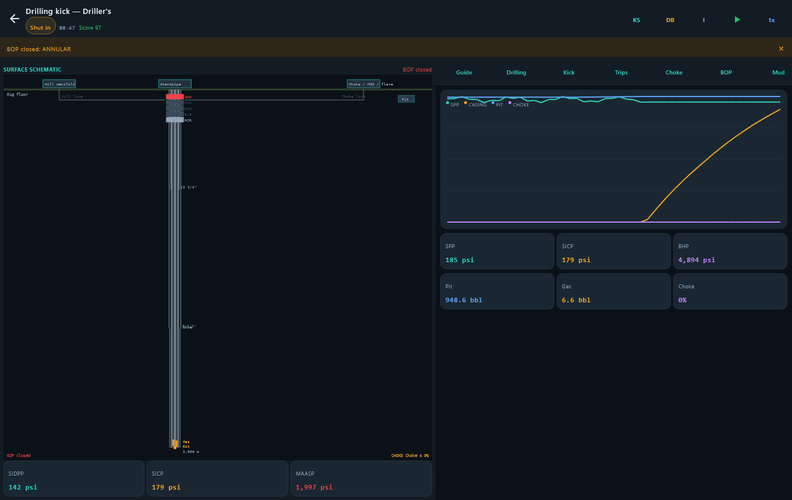
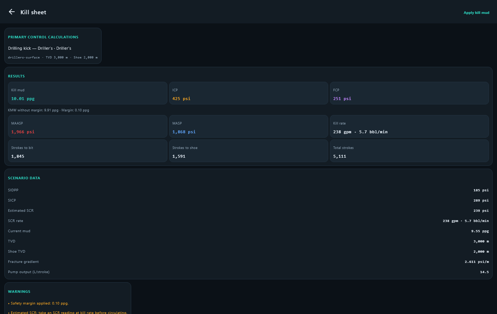

# Well Control Free Simulator

[](https://github.com/mosquitobr/well-control-free-simulator/actions/workflows/ci.yml)
[](https://github.com/mosquitobr/well-control-free-simulator/releases/latest)
[](LICENSE)
[](#downloads--installation)
[](#privacy--security)

> **Leia em Português:** [README.pt-BR.md](README.pt-BR.md)

**Well Control Free Simulator** (*Controle de Poço 2*) is a free, open-source, **100% offline** educational simulator for oil & gas well control engineering, available natively for **Windows 11**, **Linux / WSL2**, and **Android**.

All three platforms share the exact same pure-Kotlin physics engine (`:core`, 80 automated unit tests), modeling hydrostatic pressure, gas kick influx and migration, choke and manifold hydraulics, kill sheet calculations, and **19 progressive land and subsea scenarios** (Driller's Method, Wait & Weight, Volumetric, Lubricate & Bleed, Stripping/Trip Tank, and EDS).

> **Educational Disclaimer:** This is an independent educational simulator. It is **not** affiliated with, endorsed by, or certified by IADC, IWCF, API, or ANP, and must never be used for real-world well operations. Always follow your company's well control program and operating procedures.

---

## Screenshots

All screenshots below are captured directly from the running simulator in English and Portuguese UI modes (the app supports instant runtime switching between **PT-BR** and **EN**, and **Petrobras**, **US Field**, and **SI** unit systems):

| Home & Scenario Catalog | Active Kick Simulation (Schematic + Choke/BOP) |
| :---: | :---: |
|  |  |
| **Real-Time Pressure & Pit Gain Trends** | **Kill Sheet Calculator (KMW, ICP, FCP, MAASP)** |
|  |  |

---

## Key Features

- **Unified Physics Engine (`:core`):** Strict SI internal equations covering multi-layer casing geometry, deviated trajectories, thermal gradients, real-gas compressibility (Z-factor), annular gas migration, choke inertia, and subsea riser / choke-line friction.
- **19 Built-in Scenarios + Custom Well Editor:** Land and deepwater subsea wells, surface and subsea BOP stacks, guided step-by-step drills, and free sandbox mode.
- **Interactive Kill Sheet & Debriefing:** Live computation of Kill Mud Weight (KMW), Initial/Final Circulating Pressures (ICP/FCP), MAASP, pump stroke schedules, scoring, and local JSON result export.
- **Procedural Rig Audio:** Synthesized pump strokes, rotary drive, gas-at-surface acoustics, and alarm cues (100% procedural — zero third-party audio samples).
- **Bilingual & Multi-Unit:** Instant switching between **Portuguese (PT-BR)** and **English (EN)**, and **Petrobras**, **US Field**, and **SI** units.
- **Desktop Keyboard Shortcuts:** `Space` (Play/Pause), `1`–`9` (switch simulator tabs), `K` (Kill Sheet), `Esc` (Back).

---

## Downloads & Installation

All official installers and checksums (`SHA256SUMS.txt`) are published on the [GitHub Releases](https://github.com/mosquitobr/well-control-free-simulator/releases) page.

### Windows 11 (x64)
- **MSI Installer (recommended):** Download `WellControlFreeSimulator-<version>-windows-x64.msi` from Releases (per-user install, no admin privileges required).
- **Portable ZIP:** Download `WellControlFreeSimulator-<version>-windows-x64-portable.zip`, extract, and run `ControleDePoco2.exe`.
- **Winget** *(once manifest PR is merged into `microsoft/winget-pkgs`)*:
  ```powershell
  winget install mosquitobr.WellControlFreeSimulator
  ```
- **Verify integrity (PowerShell):**
  ```powershell
  Get-FileHash WellControlFreeSimulator-1.0.0-windows-x64.msi -Algorithm SHA256
  ```

### Linux / WSL2 (x64)
- **Debian / Ubuntu (`.deb`):**
  ```bash
  sudo apt install ./WellControlFreeSimulator-1.0.0-linux-x64.deb
  ```
- **Portable `.tar.gz`:**
  ```bash
  tar -xzf WellControlFreeSimulator-1.0.0-linux-x64-portable.tar.gz
  ./ControleDePoco2/bin/ControleDePoco2
  ```
- **Universal Uber JAR** *(requires Java 17+)*:
  ```bash
  java -jar WellControlFreeSimulator-1.0.0-linux-x64-uber.jar
  ```

### Android (8.0+ / API 26–35)
- Download `WellControlFreeSimulator-<version>-android.apk` from [GitHub Releases](https://github.com/mosquitobr/well-control-free-simulator/releases), verify its SHA-256 hash against `SHA256SUMS.txt`, and install.

---

## Building from Source

Prerequisites: **JDK 21** (e.g., Eclipse Temurin 21). Android builds additionally require **Android SDK 35** (`ANDROID_HOME`).

```bash
# Run core + desktop unit tests (works without Android SDK)
./gradlew :core:test :desktopApp:test --no-daemon

# Run the desktop simulator directly
./gradlew :desktopApp:run --no-daemon

# Package Windows MSI / Linux DEB
./gradlew :desktopApp:packageMsi --no-daemon   # on Windows
./gradlew :desktopApp:packageDeb --no-daemon   # on Linux

# Build Android debug APK (requires ANDROID_HOME)
./gradlew :androidApp:testDebugUnitTest :androidApp:assembleDebug -PenableAndroid=true --no-daemon

# Run compliance, parity, and OPSEC gates
python3 scripts/verify-parity.py
python3 scripts/verify-opsec.py
./gradlew verifyRuntimeLicenses -PenableAndroid=false --init-script scripts/verify-licenses.gradle --no-daemon
```

---

## Code Signing Policy (SignPath Foundation)

Free code signing is provided by [SignPath.io](https://signpath.io/), certificate by [SignPath Foundation](https://signpath.org/).

- **Committers & Reviewers:** `@mosquitobr` (maintainer).
- **Build & Signing Pipeline:** Official Windows installers are built exclusively from this public GitHub repository via GitHub Actions (`.github/workflows/release.yml`) with deterministic SHA-256 checksums.
- **Privacy Policy:** This application is **100% offline**. It does not transmit data over the network, does not collect telemetry, and does not access personal files outside user-initiated local save/export dialogs.

See [docs/SIGNPATH_AND_WINGET.md](docs/SIGNPATH_AND_WINGET.md) for maintainer onboarding instructions and Winget submission steps.

---

## Privacy & Security

- **100% Offline:** Zero network calls, zero analytics, zero ads, zero tracking.
- **No Sensitive Permissions:** The Android manifest declares no `INTERNET` permission.
- **Vulnerability Disclosure:** See [SECURITY.md](SECURITY.md).

---

## License & Third-Party Notices

Licensed under the **Apache License, Version 2.0** — see [LICENSE](LICENSE) and [NOTICE](NOTICE).

All application runtime dependencies across Android, Windows, and Linux are verified **Apache-2.0**. Standalone desktop installers bundle an unmodified **Eclipse Temurin OpenJDK 21** runtime (`GPL-2.0-with-classpath-exception`) and Skiko native graphics binaries (Skia BSD-3-Clause, FreeType FTL, HarfBuzz MIT) — see [THIRD-PARTY-NOTICES.txt](THIRD-PARTY-NOTICES.txt) for complete attributions.
