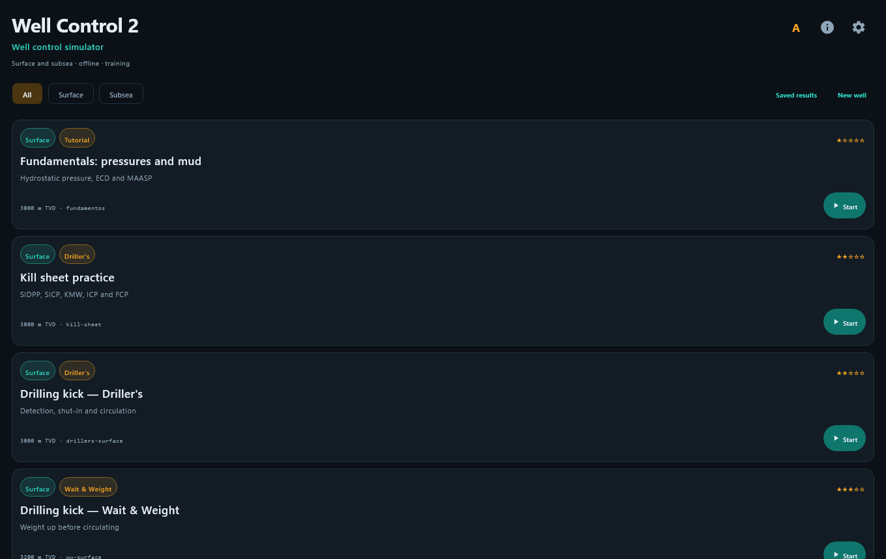
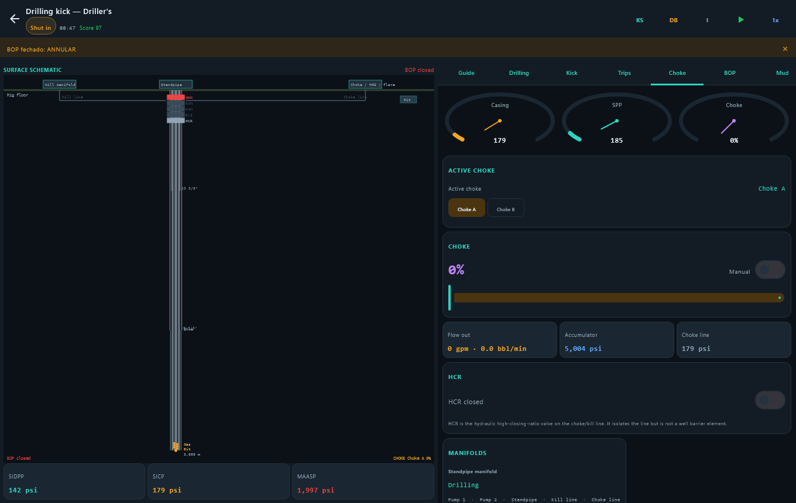
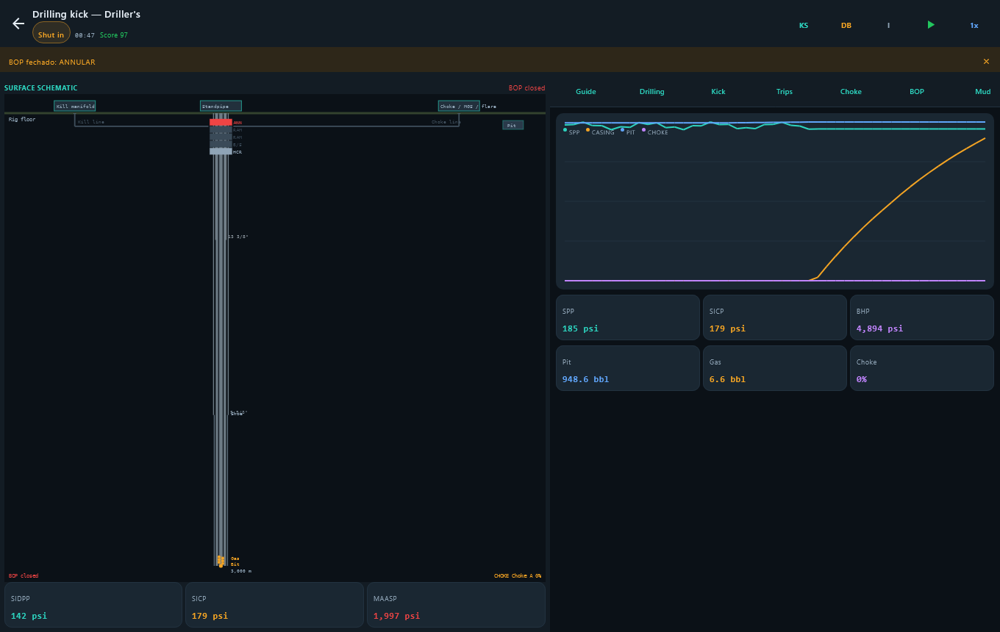
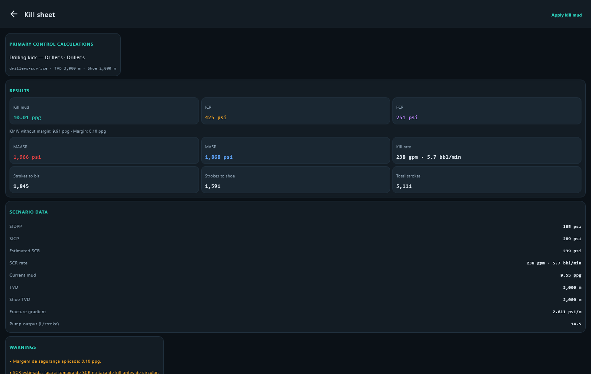

# Well Control Free Simulator (Controle de Poço 2)

[](https://github.com/mosquitobr/well-control-free-simulator/actions/workflows/ci.yml)
[](https://github.com/mosquitobr/well-control-free-simulator/releases/latest)
[](LICENSE)
[](#downloads-e-instala%C3%A7%C3%A3o)
[](#privacidade-e-seguran%C3%A7a)

> **Read in English:** [README.md](README.md)

**Well Control Free Simulator** (*Controle de Poço 2*) é um simulador educacional gratuito, de código aberto (**Apache-2.0**) e **100% offline** para engenharia de controle de poço em petróleo e gás, distribuído nativamente para **Windows 11**, **Linux / WSL2** e **Android**.

As três plataformas compartilham exatamente o mesmo motor físico em Kotlin puro (`:core`, coberto por 80 testes automatizados), modelando pressão hidrostática, influxo e migração de gás, hidráulica de choke/manifold, folha de matar (*Kill Sheet*) e **19 cenários progressivos** terrestres e submarinos (Método do Sondador, Aguardar e Pesar, Volumétrico, Lubrificar e Sangrar, Manobras/Trip Tank e EDS).

> **Aviso Educacional:** Este é um simulador educacional independente. **Não** é afiliado, endossado ou certificado pelo IADC, IWCF, API ou ANP e não deve ser utilizado em operações reais de poço. Siga sempre o programa de controle de poço e os procedimentos da sua operação.

---

## Capturas de Tela

Capturas reais do simulador em operação (suporta troca instantânea entre **PT-BR / EN** e sistemas de unidades **Petrobras**, **US Field** e **SI**):

| Tela Inicial & Catálogo de 19 Cenários | Simulação de Kick & Shut-in (Esquemático + Choke/BOP) |
| :---: | :---: |
|  |  |
| **Tendências de Pressão e Ganho de Tanque** | **Folha de Matar (KMW, ICP, FCP, MAASP)** |
|  |  |

---

## Downloads e Instalação

Todos os instaladores oficiais e hashes (`SHA256SUMS.txt`) estão disponíveis na página de [GitHub Releases](https://github.com/mosquitobr/well-control-free-simulator/releases).

### Windows 11 (x64)
- **Instalador MSI (recomendado):** baixe `WellControlFreeSimulator-<versão>-windows-x64.msi` (instalação por usuário, sem necessidade de privilégios de administrador).
- **Portátil (ZIP):** baixe `WellControlFreeSimulator-<versão>-windows-x64-portable.zip`, extraia e execute `ControleDePoco2.exe`.
- **Winget** *(após aprovação do manifesto em `microsoft/winget-pkgs`)*:
  ```powershell
  winget install mosquitobr.WellControlFreeSimulator
  ```

### Linux / WSL2 (x64)
- **Debian / Ubuntu (`.deb`):**
  ```bash
  sudo apt install ./WellControlFreeSimulator-1.0.0-linux-x64.deb
  ```
- **Portátil (`.tar.gz`)** ou **Uber JAR** *(requer Java 17+)* disponíveis na mesma Release.

### Android (8.0+ / API 26–35)
- Baixe `WellControlFreeSimulator-<versão>-android.apk` nos Releases, confira o SHA-256 em `SHA256SUMS.txt` e instale.

---

## Compilando a Partir do Código-Fonte

Pré-requisito: **JDK 21** (Eclipse Temurin). Para o módulo Android, é necessário também o **Android SDK 35** (`ANDROID_HOME`).

```bash
# Testes do motor :core e do Desktop (não requer Android SDK)
./gradlew :core:test :desktopApp:test --no-daemon

# Executar o aplicativo Desktop
./gradlew :desktopApp:run --no-daemon

# Validações de paridade, OPSEC e licenças Apache-2.0
python3 scripts/verify-parity.py
python3 scripts/verify-opsec.py
./gradlew verifyRuntimeLicenses -PenableAndroid=false --init-script scripts/verify-licenses.gradle --no-daemon
```

---

## Privacidade e Segurança

- **100% Offline:** zero chamadas de rede, zero telemetria, zero anúncios e zero rastreamento.
- **Assinatura de Código (Windows):** preparado para assinatura gratuita open-source via **SignPath Foundation** (`SignPath.io`) — consulte [docs/SIGNPATH_AND_WINGET.md](docs/SIGNPATH_AND_WINGET.md).
- **Divulgação de Vulnerabilidades:** consulte [SECURITY.md](SECURITY.md).

---

## Licença e Avisos de Terceiros

Distribuído sob a **Apache License, Version 2.0** — consulte [LICENSE](LICENSE), [NOTICE](NOTICE) e [THIRD-PARTY-NOTICES.txt](THIRD-PARTY-NOTICES.txt).
